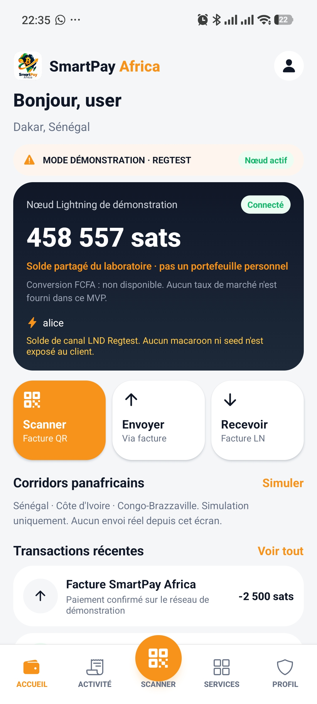
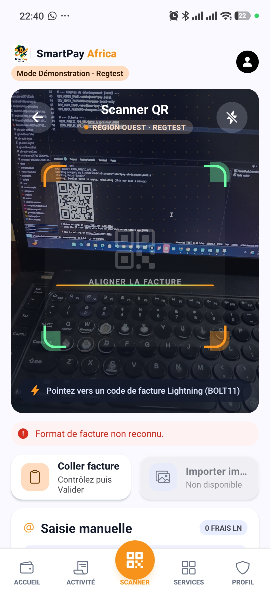
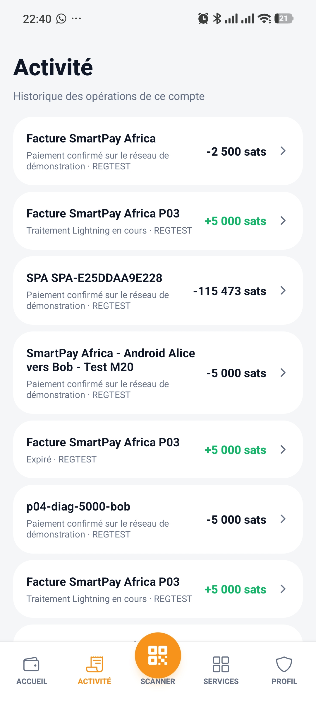
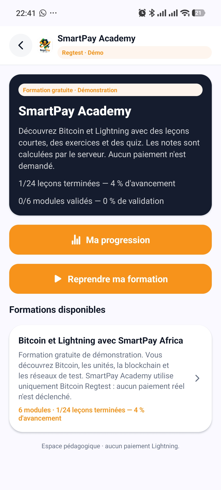
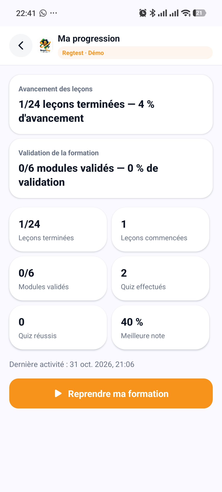
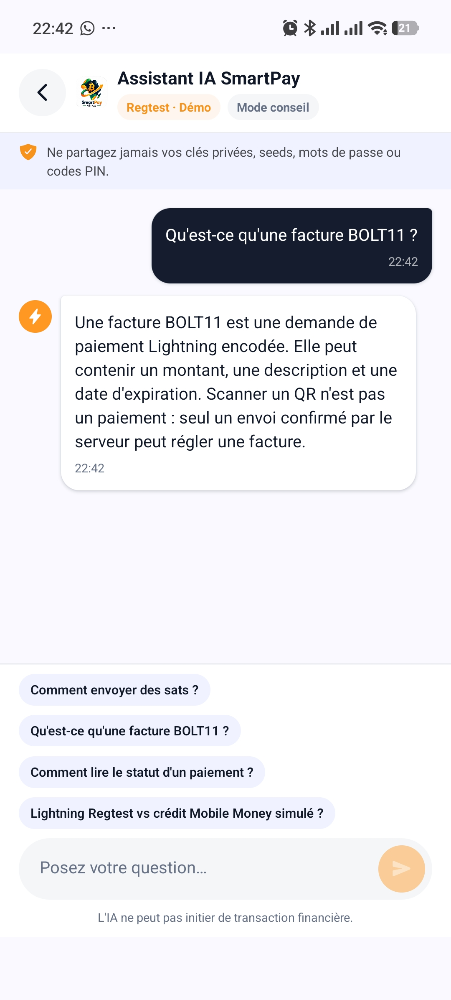
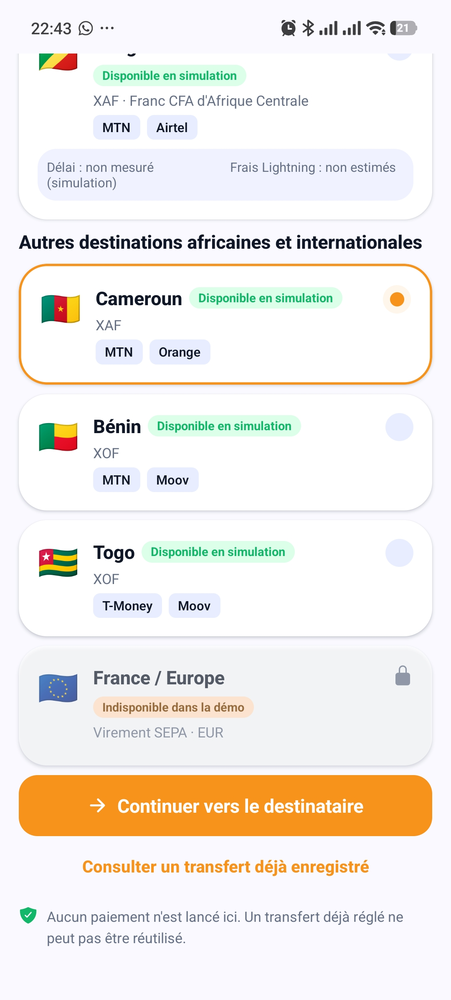
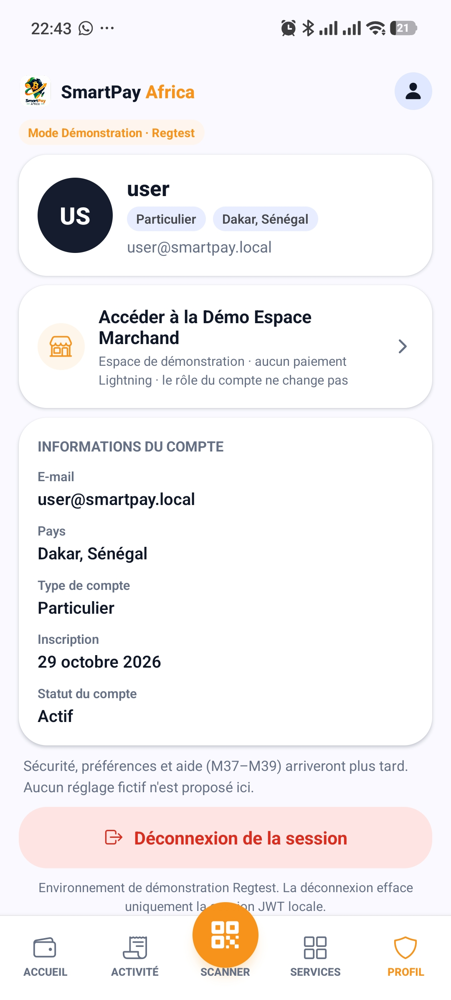

# SmartPay Africa

SmartPay Africa is a **laboratory MVP** built for [Dakar Bitcoin Hack 2026](https://devpost.com/software/smartpay-africa). It explores how Bitcoin Lightning can make cross-border payment flows easier to understand and to demonstrate for users in Senegal, Congo-Brazzaville, and Côte d'Ivoire.

This repository is a **Regtest demonstration**, not a production financial platform. It does not move real bitcoin, real CFA francs, or real Mobile Money.

| Resource | Link |
| --- | --- |
| Demo video | [YouTube](https://youtu.be/yC8v8iJtbFc) |
| Hackathon submission | [Devpost — SmartPay Africa](https://devpost.com/software/smartpay-africa) |
| Evaluator guide | [docs/DEMO.md](docs/DEMO.md) |
| Limitations | [docs/MVP_LIMITATIONS.md](docs/MVP_LIMITATIONS.md) |
| Submission notes | [docs/HACKATHON_SUBMISSION.md](docs/HACKATHON_SUBMISSION.md) |

## SmartPay Africa — Android MVP Screenshots

Real Expo Go captures from the running Regtest lab (not Stitch mockups). Demo video: [YouTube](https://youtu.be/yC8v8iJtbFc) · Submission: [Devpost](https://devpost.com/software/smartpay-africa).

<table>
  <tr>
    <td align="center" width="25%">
      <br />
      <strong>1. Accueil</strong><br />
      <sub>Nœud Alice partagé · Regtest</sub>
    </td>
    <td align="center" width="25%">
      <br />
      <strong>2. Scanner Lightning</strong><br />
      <sub>Prévisualisation de facture · pas un paiement</sub>
    </td>
    <td align="center" width="25%">
      <br />
      <strong>3. Historique</strong><br />
      <sub>Opérations du compte · étiquettes REGTEST</sub>
    </td>
    <td align="center" width="25%">
      <br />
      <strong>4. SmartPay Academy</strong><br />
      <sub>Formation Bitcoin / Lightning</sub>
    </td>
  </tr>
  <tr>
    <td align="center" width="25%">
      <br />
      <strong>5. Progression Academy</strong><br />
      <sub>Leçons et quiz · aucun paiement</sub>
    </td>
    <td align="center" width="25%">
      <br />
      <strong>6. Assistant pédagogique</strong><br />
      <sub>FAQ déterministe · mode conseil</sub>
    </td>
    <td align="center" width="25%">
      <br />
      <strong>7. Transfert simulé</strong><br />
      <sub>Corridors de démo · aucun envoi réel</sub>
    </td>
    <td align="center" width="25%">
      <br />
      <strong>8. Profil</strong><br />
      <sub>Compte lab · démo marchand locale</sub>
    </td>
  </tr>
</table>

Sources: [`docs/demo/screens/`](docs/demo/screens/). Stitch HTML under `docs/stitch/` remains design reference only.

## The Problem

Digital payments and remittances in West and Central Africa often cross several systems: bank rails, Mobile Money operators, and cash agents. Each hop can add delay, fees, and uncertainty about whether a payment actually settled.

Bitcoin Lightning is interesting here because a payment can be prepared as an invoice, previewed, then confirmed, with a cryptographic settlement proof. The challenge is product, not slogans: users still need a clear wallet, a scanner, an explicit confirmation step, and honest labels when a corridor is only simulated.

SmartPay Africa does not claim to replace banks or Mobile Money operators. It shows a working Lightning lab path and teaches the vocabulary around it.

## Our Solution

The MVP connects a React Native wallet to a Django API that talks to a local Bitcoin Core + LND **Regtest** network (nodes Alice and Bob).

A demonstration payment works like this:

1. Bob issues a BOLT11 invoice.
2. The mobile app scans or pastes it and calls **preview only**.
3. The user confirms explicitly.
4. Django asks Alice to pay, then **looks up** LND. An HTTP 200 is never treated as settlement.
5. The history screen shows the real Django payment. The assistant can explain that payment in pedagogical language.

Around that core, the app includes a deterministic FAQ assistant, SmartPay Academy (six published modules), a Direct Transfer **preparation** flow with simulated Mobile Money, a local merchant demo, and a read-mostly admin console.

## MVP Features

| Area | Status | What it actually does |
| --- | --- | --- |
| JWT auth | **Operational** | Register (always `individual`), login, refresh. Logout calls `POST /api/v1/auth/logout/` to blacklist the **refresh** token (SimpleJWT `token_blacklist`). Access tokens already issued remain valid until they expire (~30 minutes). |
| Wallet screen | **Operational (lab)** | Shows the **shared Alice node** channel balance when `PAYMENT_PROVIDER=lnd_regtest`, or a labeled Mock balance. Not a personal LND wallet per user. |
| Receive invoice | **Operational on Regtest** | `POST /api/v1/payments/invoices/` returns `lnbcrt…` (or `mockln1…` in Mock). |
| Scanner | **Operational** | Preview only. No payment is sent from this screen. |
| Pay + history | **Operational on Regtest** | Explicit confirm + LND lookup. Alice → Alice is rejected. |
| Direct Transfer | **Simulated / blocked on mobile** | Django quotes and prepares a transfer. The mobile app **does not** call confirm. The API confirm route still exists (see limitations). |
| Mobile Money credit | **Simulated** | After a confirmed transfer, Django records `MM-SIM-…`. No Wave / Orange Money / MTN API. |
| SmartPay Academy | **Operational** | 6 published modules, 24 lessons, 6 quizzes, 70% pass mark, owner-scoped progress. |
| Assistant | **Operational (deterministic)** | FAQ engine. No LLM. Cannot pay, invoice, or confirm. |
| Transaction explain | **Operational** | Reads `GET /api/v1/payments/{id}/` and explains it locally. |
| Merchant space | **Local demo** | In-memory specimen. No Lightning invoice. |
| Admin console | **Operational (mostly GET)** | Users, merchants, corridors, infrastructure, audit, settings. Home dashboard uses **illustrative** figures. |
| Faucet / Pay shop | **Not available** | Shown as out of phase. |

## How It Works

Lightning demo path (Alice pays Bob):

```text
Phone / Expo  →  Django API  →  LND Alice  →  Bitcoin Core Regtest
                      │
                      └── LND Bob (counterparty invoice only)
```

1. Start PostgreSQL + API, then the Lightning lab, then attach the API with `compose.regtest.yaml`.
2. Sign in with a local individual account.
3. Create a **Bob** invoice (`POST /api/v1/lab/counterparty-invoice/` from the Receive lab card, or an equivalent lab tool).
4. Scan or paste on the Scanner. The app calls `POST /api/v1/payments/preview/`.
5. Confirm. The app sends `confirm: true` and an `Idempotency-Key`.
6. Django pays from Alice, then stores settlement only after LND lookup (`SUCCEEDED` / `SETTLED`).
7. Open Activity. Optionally open the assistant explanation (personal accounts only).

Full evaluator steps: [docs/DEMO.md](docs/DEMO.md).

## Architecture

| Component | Role |
| --- | --- |
| `apps/mobile` | Expo 52 wallet, scanner, Academy, assistant |
| `apps/api` | Django 5.2 / DRF, JWT, payments, transfers, Academy, assistant, admin APIs |
| `apps/admin-web` | Next.js 15 console |
| `packages/contracts` | OpenAPI 3 + TypeScript types (partial vs live API) |
| PostgreSQL 16 | Application data (host port **5433**) |
| Bitcoin Core 29.0 | Regtest chain |
| LND Alice | Payer node used by Django |
| LND Bob | Counterparty only |

Details and diagrams: [docs/architecture/overview.md](docs/architecture/overview.md).

## Technology Stack

Verified from this repository (not marketing versions):

| Layer | Choice |
| --- | --- |
| Node.js | 22 LTS (`.nvmrc`) — `package.json` engines `>=20 <23` |
| Mobile | React Native 0.76.9, Expo ~52.0.28, TypeScript |
| Admin | Next.js 15, React 19, Tailwind CSS |
| API | Python 3.13, Django 5.2.11, DRF 3.16.1, SimpleJWT 5.5.1, httpx 0.28.1 |
| Database | PostgreSQL 16 (`postgres:16-alpine`) |
| Lightning | `bitcoin/bitcoin:29.0`, `lightninglabs/lnd:v0.20.6-beta` |
| Tests | pytest-django (SQLite in-memory), Node `tsx --test` |
| CI | `.github/workflows/api-tests.yml` — API pytest only |

## Quick Start

Supported day-to-day environment: **Windows + PowerShell + Docker**. Equivalent Docker Compose commands work elsewhere; the helper scripts are PowerShell.

```powershell
copy .env.example .env
# Edit .env locally. Never commit it.
# For a physical phone, set EXPO_PUBLIC_API_URL=http://<LAN-IP>:8000
# and add that host to DJANGO_ALLOWED_HOSTS.

docker compose up --build -d
# Health: http://localhost:8000/api/v1/health/
```

`scripts/dev-up.ps1` copies `.env.example` when `.env` is missing, then runs `docker compose up --build` **in the foreground**.

Lightning lab (separate compose file, separate volumes):

```powershell
.\scripts\lightning-lab.ps1 up
.\scripts\lightning-lab.ps1 init
docker compose -f compose.yaml -f compose.regtest.yaml up -d api
```

Frontends (Node 22):

```powershell
nvm use 22
npm install
npm run dev:admin
# Admin: http://localhost:3000
cd apps\mobile
npx expo start --port 8084
```

Use **8084**, not the Expo default 8081. LND Alice REST is already bound to `127.0.0.1:8081`.

Do **not** run `docker compose down -v` on the root compose file if you need to keep `smartpay_pgdata`.

Academy catalogue is loaded with `manage.py seed_academy` (refused when `DEBUG` is false, unless `--force`). That command is **not** started automatically.

## Testing

Isolated backend tests (SQLite, Mock provider — does not use shared PostgreSQL or LND):

```powershell
.\scripts\test-api.ps1
# or, if the API container is already running:
docker exec -e DJANGO_SETTINGS_MODULE=config.settings.test smartpay-api python -m pytest
```

Frontends:

```powershell
npm test -w @smartpay/mobile
npm run typecheck -w @smartpay/mobile
npm test -w @smartpay/admin-web
```

Do not point pytest at development settings against the shared lab database.

## Demo

Step-by-step evaluator path: [docs/DEMO.md](docs/DEMO.md).

## Current Limitations

See the full list in [docs/MVP_LIMITATIONS.md](docs/MVP_LIMITATIONS.md).

- Bitcoin **Regtest** only. No Mainnet, no real bitcoin.
- One LND payer node (Alice) is shared by the API. Users do not each have an isolated Lightning wallet.
- Mobile Money is simulated. No Wave, Orange Money, or MTN connection.
- Direct Transfer confirm is **disabled in the mobile app**. The Django confirm endpoint can still change lab state if called directly.
- The assistant is a deterministic FAQ, not a generative model.
- The admin home dashboard includes illustrative numbers next to real read-only lists.
- No public production deployment.

## Security

Secrets live in a local `.env` and in gitignored LND files under `infrastructure/lightning-regtest/secrets/`. They must never be pasted into the app, the admin UI, or Git.

The lab is designed for a local machine or a trusted LAN. `DEBUG`, JWT, and Docker port bindings are not hardened for the public Internet.

Details: [docs/security/overview.md](docs/security/overview.md).

## Roadmap

These items are **not** in the MVP:

- Mainnet or testnet with real funds
- Per-user Lightning nodes or custody
- Live Mobile Money or bank rails
- Transfer confirm from the mobile app
- Generative LLM assistant
- Faucet and in-app shop payment
- Production hosting, KYC, and licensing

## Hackathon

Built for **Dakar Bitcoin Hack 2026**.

- Devpost: [smartpay-africa](https://devpost.com/software/smartpay-africa)
- Demo video: [youtu.be/yC8v8iJtbFc](https://youtu.be/yC8v8iJtbFc)
- Working notes (not official rules): [docs/HACKATHON_SUBMISSION.md](docs/HACKATHON_SUBMISSION.md)

## Documentation

- [Demo](docs/DEMO.md)
- [Architecture](docs/architecture/overview.md)
- [API endpoints](docs/api/endpoints.md)
- [Security](docs/security/overview.md)
- [MVP limitations](docs/MVP_LIMITATIONS.md)
- [Hackathon submission draft](docs/HACKATHON_SUBMISSION.md)
- [License decision](docs/LICENSE_DECISION.md)
- [Lightning lab](infrastructure/lightning-regtest/README.md)
- [Stitch mockups](docs/stitch/README.md) (design references, not the running app)

## License

No project license has been chosen yet. Publishing a repository does not grant reuse rights. See [docs/LICENSE_DECISION.md](docs/LICENSE_DECISION.md).
