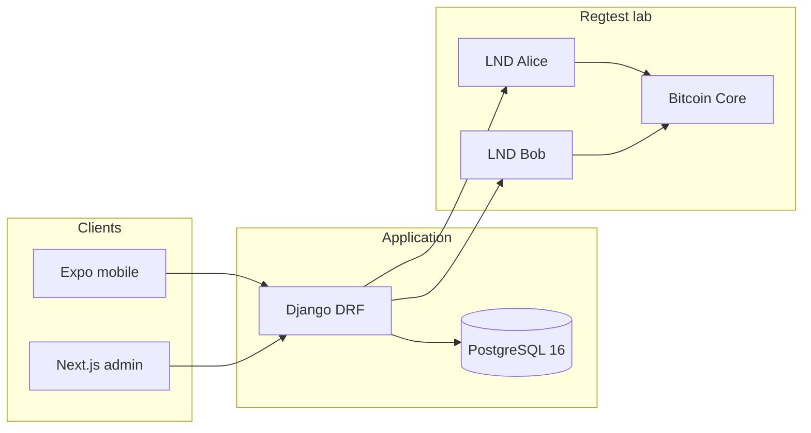

# Architecture — SmartPay Africa

Laboratory MVP for Dakar Bitcoin Hack 2026. Bitcoin **Regtest** only. No Mainnet. No real CFA deposit.

## Components

| Component | Path / image | Responsibility |
| --- | --- | --- |
| Mobile app | `apps/mobile` | Expo 52 wallet, scanner, confirm, receive, transfer UI, Academy, assistant, local merchant demo |
| Django API | `apps/api` | Auth, wallet snapshot, payments, transfers, Academy, assistant, admin APIs |
| PostgreSQL | `postgres:16-alpine` | Users, payments, transfers, Academy progress, conversations. Host **5433** |
| Admin console | `apps/admin-web` | Next.js 15, JWT in `sessionStorage`, mostly read-only |
| LND Alice | `lightninglabs/lnd:v0.20.6-beta` | Payer node used by Django (`PAYMENT_PROVIDER=lnd_regtest`) |
| LND Bob | same image | Counterparty invoices and settlement lookup |
| Bitcoin Core | `bitcoin/bitcoin:29.0` | Regtest chain and mining |
| Mock Mobile Money | Django models + disclaimer | `SimulatedMobileMoneyCredit` after a confirmed transfer — **no operator HTTP** |
| SmartPay Academy | `smartpay.academy` | Published catalogue, quizzes, owner progress |
| Pedagogical assistant | `smartpay.ai_assistant` | Deterministic FAQ, owner conversations |
| Contracts | `packages/contracts` | OpenAPI + TS types (not complete vs live routes) |

## Payment providers

- `MockPaymentProvider`: invoices `mockln1…`. `is_lightning_settled` stays **false**.
- `LndRegtestPaymentProvider`: invoices `lnbcrt…`. Auth is a **file** macaroon. Settlement is LND lookup (`SETTLED` / `SUCCEEDED`), never a bare HTTP 200.

`PAYMENT_PROVIDER` is `mock` or `lnd_regtest`. Compose root defaults to Mock. Overlay `compose.regtest.yaml` forces LND.

## Diagram

Docker networks:

- `smartpay` — API + PostgreSQL
- `smartpay-lightning` — bitcoind, lnd-alice, lnd-bob (external to the root compose)

LND REST is published on `127.0.0.1` only (8081 Alice, 8082 Bob). Bitcoin RPC and LND gRPC are not offered as client APIs.

## Mobile

The app talks **only** to Django (`EXPO_PUBLIC_API_URL`). It never reads a macaroon or calls LND.

Tabs: Home, Activity, Scanner, Services, Profile.

Stacks: Confirm, Receive, Transfer (5 screens), Merchant (local), Assistant (home / chat / explain), Academy (7 screens).

## Flows

### 1. Authentication

1. `POST /api/v1/auth/register/` — public, role forced to `individual`, no JWT.
2. `POST /api/v1/auth/token/` — email + password → access + refresh.
3. `GET /api/v1/me/` — profile. Admin console also requires `role=admin`.
4. `POST /api/v1/auth/token/refresh/` on 401.
5. Mobile logout clears SecureStore. There is **no** server blacklist.

### 2. Invoice creation

- User receive: `POST /api/v1/payments/invoices/` → Alice (LND) or Mock invoice.
- Lab Bob: `POST /api/v1/lab/counterparty-invoice/` when enabled.

### 3. Preview

`POST /api/v1/payments/preview/` with `encoded_invoice`. No `Payment` row. `is_lightning_settled` is always false on preview. Scanner never calls create.

### 4. Explicit confirmation

`POST /api/v1/payments/` with invoice, `Idempotency-Key`, and `confirm`. The mobile client sends `confirm: true`. The serializer currently **defaults `confirm` to true** if omitted (API risk; see [security](../security/overview.md)).

Alice → Alice (destination equals local pubkey) is rejected.

### 5. Payment verification

`GET /api/v1/payments/{id}/` runs `reconcile_payment` (LND lookup). `manage.py reconcile_payments` does the same for pending rows. Only lookup `SETTLED` / `SUCCEEDED` sets `is_lightning_settled`.

### 6. Academy

Authenticated GETs for published courses/modules/lessons/quizzes (404 for missing and unpublished).
`POST .../start/`, `.../complete/`, `.../attempts/` write **owner** progress. GET progress is computed live from `LessonProgress` and `QuizAttempt`.

A module is complete only if every published lesson is completed **and** (if a published quiz exists) at least one attempt has `passed=true`.

### 7. Simulated transfer

Mobile: destinations → beneficiary → quote → ready → preview-payment → result.

- Quote uses a **fictitious** rate (`TRANSFER_DEMO_FCFA_PER_BTC`, default 43_300_000 FCFA / BTC in settings).
- `ready` and `preview-payment` do **not** send Lightning.
- Mobile does **not** call `POST /transfers/{id}/confirm/`.
- If confirm is invoked on the API with LND up, Django may pay Alice → Bob and then write a **simulated** Mobile Money credit. That is not an operational cross-border payout.

## What this architecture is not

- Not one Lightning node per user
- Not a production custody platform
- Not a licensed remittance operator
- Not a live Wave / Orange Money / MTN integration
